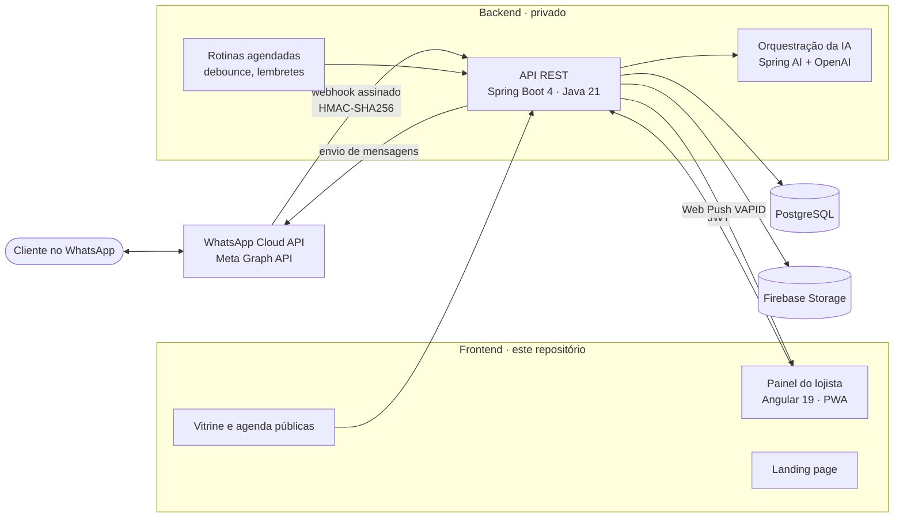

<div align="center">


# DizAI

**Atendente com IA no WhatsApp para pequenos negócios.**

Confeitarias, salgaderias, manicures, barbearias e lojas cadastram o negócio uma vez,
conectam o WhatsApp Business e o assistente passa a responder os clientes, montar pedidos
e marcar horários sozinho, 24 horas por dia.


</div>

---

## Sumário

- [O problema e a ideia](#o-problema-e-a-ideia)
- [O que o DizAI faz](#o-que-o-dizai-faz)
- [Arquitetura](#arquitetura)
- [Frontend: decisões técnicas](#frontend-decisões-técnicas)
- [Backend (repositório privado)](#backend-repositório-privado)
- [Como rodar o frontend](#como-rodar-o-frontend)
- [Estrutura de pastas](#estrutura-de-pastas)
- [Sobre o autor](#sobre-o-autor)

---

## O problema e a ideia

O pequeno negócio brasileiro vende pelo WhatsApp. E passa o dia respondendo as mesmas perguntas:
*"quanto custa?"*, *"tem para amanhã?"*, *"quais sabores?"*, *"tem horário sexta?"*. Quem está com a mão
ocupada (a manicure atendendo, a confeiteira no forno) perde cliente, principalmente à noite e no fim de semana.

O **DizAI** é um SaaS que resolve isso com um assistente de IA treinado **com os dados do próprio negócio**
(produtos, serviços, regras, horários, galeria de fotos) e que conversa no WhatsApp com a voz da loja. Ele não
"inventa": o que depende de regra de negócio (prazos, horários livres, confirmações) é calculado por código,
e a IA só conduz a conversa.

## O que o DizAI faz

| | Recurso | Detalhes |
|---|---|---|
| 🤖 | **Atendimento com IA no WhatsApp** | Respostas com base no catálogo, nas perguntas frequentes e nas instruções obrigatórias da loja. Saudação automática, envio de catálogo (PDF/imagens) e link da galeria. |
| 🧾 | **Pedidos (lojas de produtos)** | A IA coleta as escolhas obrigatórias (sabor, tamanho, variações de preço, adicionais), envia o resumo, coleta os dados de fechamento e passa para o dono com o resumo estruturado. Tela de pedidos estilo "quadro de cozinha", com avisos de *pronto* e *entregue* pelo WhatsApp e números de faturamento. |
| 📅 | **Agenda automática (serviços)** | A IA consulta os horários livres (considerando a duração de cada serviço, folgas e antecedência), agenda, remarca e cancela. Página pública de agendamento, lembrete com confirmação de presença e agradecimento depois do atendimento. |
| 🖼️ | **Vitrine pública** | Galeria de trabalhos personalizável (cor, fonte, capa) em `/l/{loja}`, com prévia de link (Open Graph) para WhatsApp e Instagram, e botão para o cliente enviar uma foto direto para a loja. |
| 🔔 | **PWA com notificações** | O painel instala como app no celular e recebe Web Push quando um pedido está pronto para fechar. |
| 📊 | **Gestão** | Estatísticas (atendimentos, pedidos, tempo economizado), perguntas que a IA não soube responder viram sugestões de FAQ, e um painel administrativo da plataforma (lojas, conexões, custo estimado de IA). |
| 🧪 | **Teste do atendimento** | O lojista conversa com o próprio assistente dentro do painel antes de ligar no WhatsApp. |

## Arquitetura



## Frontend: decisões técnicas

O frontend é uma **SPA em Angular 19** com foco em celular (é onde o lojista vive), usando as APIs mais modernas
do framework.

**Angular moderno**
- **100% standalone components** (sem `NgModule`), com **lazy loading** de todas as telas por `loadComponent`.
- **Signals** como base do estado: `signal`, `computed`, `linkedSignal`, `effect` e `afterRenderEffect`.
  Entradas e saídas com as funções **`input()` / `output()` / `model()`** e consultas com **`viewChild()`**.
- **`ChangeDetectionStrategy.OnPush`** nos componentes e `provideZoneChangeDetection({ eventCoalescing: true })`.
- **Nova sintaxe de template**: `@if`, `@for` (com `track`), `@switch`, `@let`.
- **Router** com `withComponentInputBinding()` (parâmetros de rota direto como `input()`),
  `withInMemoryScrolling`, **guards funcionais** (`CanActivateFn`), **resolvers** (`ResolveFn`) e
  **redirects funcionais**.
- **HttpClient** com `withFetch()` e **interceptor funcional** (`HttpInterceptorFn`) que injeta o JWT e trata
  a sessão expirada.
- **Reactive Forms tipados** (`FormBuilder.nonNullable`, `FormArray`, validadores próprios e de grupo).

**Arquitetura do código**
- Separação em `core` (serviços, modelos, autenticação, utilitários), `shared` (componentes reutilizáveis) e
  `features` (uma pasta por tela).
- **Serviços com estado em signals** (um "store" leve por domínio), com carregamento único compartilhado entre telas
  e atualização silenciosa (ex.: a tela de pedidos se atualiza sozinha e ao voltar para a aba).
- **Componentes reutilizáveis** próprios: bottom sheet acessível, faixa de dias, menu de ações, editor de mensagem com
  etiquetas e prévia no formato do WhatsApp, visualizador de fotos, toasts, tour de onboarding e vídeos tutoriais
  animados em CSS.
- **Conteúdo por ramo de negócio**: textos, exemplos e sugestões mudam conforme o ramo (confeitaria, manicure,
  loja…) a partir de uma única configuração tipada.

**Experiência e interface**
- **Design system próprio** em CSS puro com *design tokens* (custom properties), sem biblioteca de UI.
- **Mobile first** e responsivo: no computador, as telas viram layouts de duas colunas e quadros (ex.: pedidos).
- **Acessibilidade**: papéis ARIA (`tablist`, `dialog`, `switch`, `radiogroup`), `aria-live`, foco gerenciado
  nos modais e respeito a `prefers-reduced-motion`.
- **Landing page interativa**: demonstrações com o painel e conversas reais animadas (cadastro → atendimento →
  pedido / agendamento), desenhadas em escala real a partir das telas do app.

**PWA e integrações**
- **Manifest**, **service worker** próprio (`public/sw.js`) e **Web Push** com chaves VAPID para avisar o lojista.
- **Cadastro incorporado da Meta** (Embedded Signup do Facebook SDK) para conectar o WhatsApp Business em modo
  coexistência.
- Imagens no **Firebase Storage** (o banco guarda só a referência; o front monta a URL com um pipe).
- **Vercel** para hospedagem, com *rewrites* por user-agent que entregam as prévias de link (Open Graph) aos robôs
  do WhatsApp e do Instagram, e **Vercel Analytics**.

## Backend (repositório privado)

O backend fica em um **repositório privado**, porque concentra as estratégias do negócio: a engenharia de prompt
por tipo de negócio, as regras de atendimento e a lógica de pedidos e agenda. As tecnologias e práticas usadas:

- **Java 21** e **Spring Boot 4** (Spring Web MVC, Spring Data JPA / Hibernate, Bean Validation).
- **Spring AI** com a API da OpenAI e **saída estruturada** (JSON com schema validado): a IA devolve uma decisão
  tipada (responder, transferir para o dono, agendar, cancelar…) que o sistema valida antes de executar.
- **Engenharia de prompt** com regras fixas no início do *system prompt* para aproveitar o **prompt caching**, e o
  contexto que muda a cada mensagem (agenda livre, prazos, data e hora) na mensagem do usuário.
- **Spring Security** como **OAuth2 Resource Server com JWT**, autorização por dono do recurso e por papel (admin),
  senhas com BCrypt.
- **PostgreSQL**, com **bloqueio pessimista** (`SELECT ... FOR UPDATE`) na agenda e no processamento das conversas
  para evitar horário duplicado e respostas em dobro.
- **Processamento assíncrono das conversas**: *debounce* das mensagens do cliente, *lease* para que só um
  processador atenda cada conversa e rotinas com `@Scheduled` (lembretes, agradecimentos).
- **WhatsApp Cloud API** (Graph API): webhook com verificação de assinatura **HMAC-SHA256**, envio de texto, mídia
  e modelos aprovados, e tratamento da janela de 24 h.
- **Criptografia AES-256-GCM** para os tokens de acesso do WhatsApp guardados no banco.
- **Firebase Admin SDK** (Storage) para as imagens, **Web Push (VAPID)** e prévias **Open Graph** geradas no servidor.
- **Testes** com JUnit 5, AssertJ, Spring Boot Test e MockMvc (cerca de 160 testes de integração e unidade, com
  uma IA "roteirizada" para testar os fluxos de conversa sem chamar a OpenAI).
- **Docker** (build em múltiplas etapas) e deploy no **Railway**, com perfil de produção que recusa subir com
  segredos de desenvolvimento.

## Como rodar o frontend

Pré-requisitos: **Node.js 20+** e o backend rodando em `localhost:8080`.

```bash
npm install
npm start
```

Abra `http://localhost:4200`. O `proxy.conf.json` repassa `/api`, `/public`, `/arquivos` e `/webhooks` para o backend.

| Script | O que faz |
|---|---|
| `npm start` | Servidor de desenvolvimento (`ng serve`) |
| `npm run start:celular` | O mesmo, aberto na rede local para testar pelo celular |
| `npm run build` | Build de produção em `dist/` |
| `npm test` | Testes unitários (Karma + Jasmine) |

## Estrutura de pastas

```
src/app
├── core/                # o que é usado pelo app todo
│   ├── api/             # URL da API e mensagens de erro
│   ├── auth/            # sessão, interceptor do JWT, guards e resolvers
│   ├── constants/       # conteúdo por ramo, cores, opções
│   ├── models/          # interfaces tipadas dos dados da API
│   ├── pwa/             # instalação do app e notificações push
│   ├── services/        # estado em signals + chamadas HTTP, um por domínio
│   ├── utils/           # datas da agenda, telefone, validadores...
│   └── whatsapp/        # cadastro incorporado da Meta
├── shared/              # componentes, pipes e estilos reutilizáveis
└── features/            # uma pasta por tela
    ├── landing/         # página inicial e demonstração interativa
    ├── painel/          # painel do lojista (onboarding, resumo, atalhos)
    ├── atendimento/     # como o assistente atende (regras, catálogo...)
    ├── produtos/        # produtos e serviços
    ├── chats/           # conversas que precisam do dono
    ├── pedidos/         # quadro de pedidos e números
    ├── agenda/          # agenda, configurações e mensagens
    ├── galeria/         # galeria de fotos e personalização da vitrine
    ├── vitrine-publica/ # vitrine, agenda e foto públicas
    └── admin/           # gerenciamento da plataforma
```

## Sobre o autor

Desenvolvido por **João Pedro** ([@joaopedro1422](https://github.com/joaopedro1422)), desenvolvedor **full-stack**:
do produto e do design das telas ao backend, à integração com a IA e o WhatsApp e ao deploy.

O DizAI é um projeto autoral, pensado e construído de ponta a ponta: definição do produto, interface, arquitetura,
regras de negócio, integração com a IA e o WhatsApp e infraestrutura.

---

<div align="center">
<sub>© DizAI. Código do frontend publicado para portfólio; o backend é privado.</sub>
</div>
