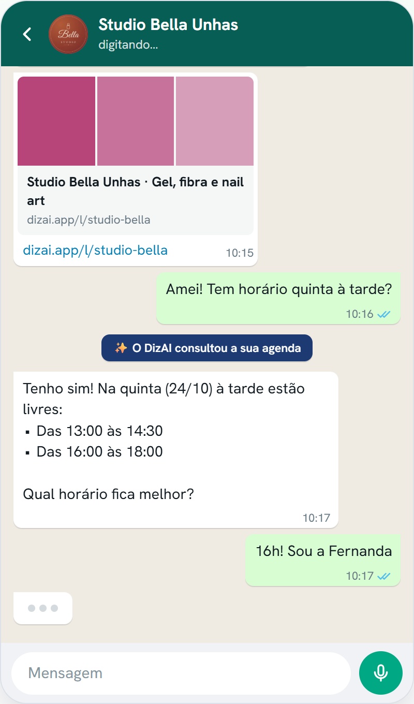
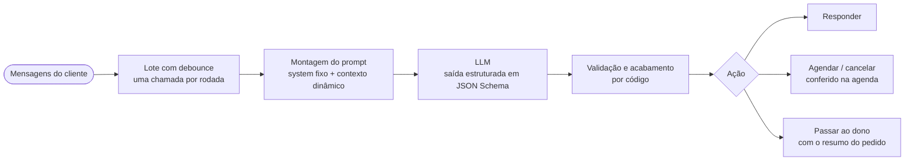
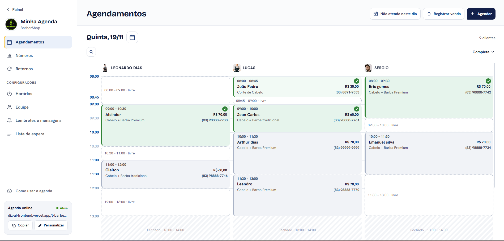
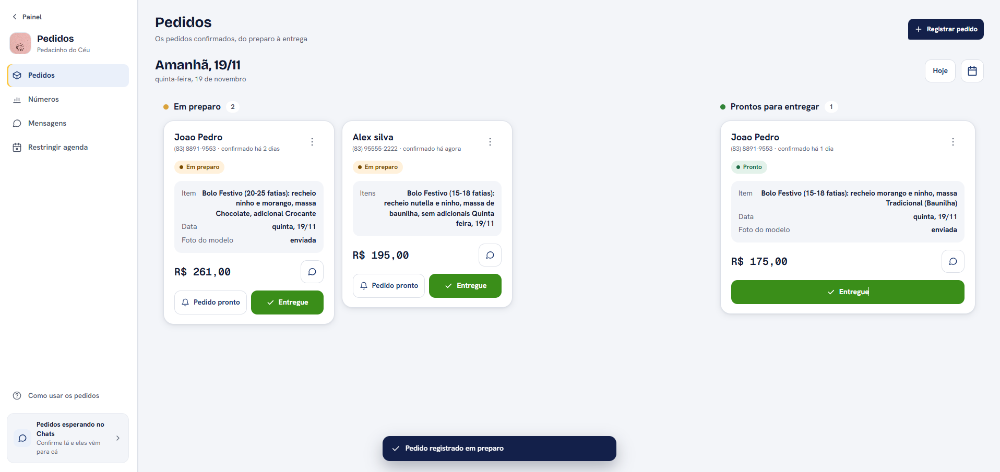

<div align="center">


# DizAI

**Atendente com IA no WhatsApp para pequenos negócios.**

Confeitarias, salgaderias, manicures, barbearias e lojas cadastram o negócio uma vez,
conectam o WhatsApp Business e o assistente passa a responder os clientes, montar pedidos
e marcar horários sozinho, 24 horas por dia.


**Acesse em: [diz-ai-frontend.vercel.app](https://diz-ai-frontend.vercel.app)**

</div>

---

## Sumário

- [O problema e a ideia](#o-problema-e-a-ideia)
- [O que o DizAI faz](#o-que-o-dizai-faz)
- [Arquitetura de IA generativa e estratégias](#arquitetura-de-ia-generativa-e-estratégias)
- [Backend (repositório privado)](#backend-repositório-privado)
- [Frontend](#frontend)
- [Estrutura de pastas](#estrutura-de-pastas)
- [O painel](#o-painel)

---

## O problema e a ideia

O pequeno negócio brasileiro vende pelo WhatsApp. E passa o dia respondendo as mesmas perguntas:
*"quanto custa?"*, *"tem para amanhã?"*, *"quais sabores?"*, *"tem horário sexta?"*. Quem está com a mão
ocupada (a manicure atendendo, a confeiteira no forno) perde cliente, principalmente à noite e no fim de semana.

O **DizAI** é um SaaS que resolve isso com um assistente de IA treinado **com os dados do próprio negócio**
(produtos, serviços, regras, horários, galeria de fotos) e que conversa no WhatsApp com a voz da loja. Ele não
"inventa": o que depende de regra de negócio (prazos, horários livres, confirmações) é calculado por código,
e a IA só conduz a conversa.

Essa divisão também é o que torna o produto viável para um pequeno negócio: como a IA não precisa calcular datas,
horários nem disponibilidade, ela roda com um **modelo leve e nível de raciocínio baixo**, e o prompt é montado para
**gastar o mínimo de tokens** (regras fixas em cache, contexto só quando é relevante). O custo por conversa fica
baixo o suficiente para caber no preço que o lojista pode pagar.

<div align="center">

&nbsp;&nbsp;

<br />
<sub>Encomenda de bolo e agendamento de manicure, na demonstração do site.</sub>
</div>

## O que o DizAI faz

| | Recurso | Detalhes |
|---|---|---|
| 🤖 | **Atendimento com IA no WhatsApp** | Respostas com base no catálogo, nas perguntas frequentes e nas instruções obrigatórias da loja. Saudação automática, envio de catálogo (PDF/imagens) e link da galeria. |
| 🧾 | **Pedidos (lojas de produtos)** | A IA coleta as escolhas obrigatórias (sabor, tamanho, variações de preço, adicionais), envia o resumo, coleta os dados de fechamento e passa para o dono com o resumo estruturado. Tela de pedidos estilo "quadro de cozinha", com avisos de *pronto* e *entregue* pelo WhatsApp e números de faturamento. |
| 📅 | **Agenda automática (serviços)** | A IA consulta os horários livres (considerando a duração de cada serviço, folgas e antecedência), agenda, remarca e cancela. Página pública de agendamento, lembrete com confirmação de presença e agradecimento depois do atendimento. |
| 🖼️ | **Vitrine pública** | Galeria de trabalhos personalizável (cor, fonte, capa) em `/l/{loja}`, com prévia de link (Open Graph) para WhatsApp e Instagram, e botão para o cliente enviar uma foto direto para a loja. |
| 🔔 | **PWA com notificações** | O painel instala como app no celular e recebe Web Push quando um pedido está pronto para fechar. |
| 📊 | **Gestão** | Estatísticas (atendimentos, pedidos, tempo economizado), perguntas que a IA não soube responder viram sugestões de FAQ, e um painel administrativo da plataforma (lojas, conexões, custo estimado de IA). |
| 🧪 | **Teste do atendimento** | O lojista conversa com o próprio assistente dentro do painel antes de ligar no WhatsApp. |

## Arquitetura de IA generativa e estratégias

A pergunta que guiou o projeto foi: **o que precisa mesmo de um LLM, e o que o código faz melhor?** A IA é ótima
para entender o cliente e escrever como uma atendente; é cara e instável para fazer contas, consultar agenda e
garantir regras. Por isso cada mensagem passa por um pipeline em que o modelo decide e escreve, e o código prepara,
confere e executa.



**1. Engenharia de prompt em camadas, pensada para cache e custo**
- **System prompt fixo por tipo de negócio** (produtos ou serviços): princípios, regras numeradas, estilo e as fases
  do atendimento. Como não muda entre mensagens, fica no início do prompt e aproveita o **prompt caching** do
  provedor: a maior parte dos tokens de entrada sai com desconto.
- **Contexto dinâmico na mensagem do usuário**, montado por código a cada rodada: só entra o que é relevante naquele
  momento. Exemplos: a agenda dos próximos dias, o prazo mínimo do pedido, se o catálogo já foi enviado, o nome de um
  cliente que já comprou, a foto de modelo que acabou de chegar, os produtos do mesmo assunto quando o cliente fala
  "salgados" sem dizer qual. São blocos curtos e condicionais, em vez de um prompt gigante que tenta prever tudo.
- **Histórico recortado**: a janela de mensagens é limitada e, depois de um atendimento concluído, o histórico
  recomeça daquele ponto, para o modelo não misturar o pedido antigo com o novo (e para não pagar tokens à toa).
- **Mensagens do cliente agrupadas** (debounce): quem manda "oi", "tudo bem?", "quanto custa o bolo?" em sequência
  gera uma chamada só.

**2. Código determinístico no lugar de raciocínio**
- **Agenda pronta**: o sistema calcula os horários em que cada serviço pode começar (duração, folgas, antecedência,
  vários profissionais) e entrega a lista pronta. O modelo **não calcula horário**, só escolhe entre os que existem.
- **Prazos de pedido**: o primeiro horário possível (antecedência do produto ou da loja, horário de funcionamento,
  folga em prazos longos) é calculado por código. Quando a data pedida não dá, a recusa é escrita pelo sistema, com a
  antecedência cadastrada e a próxima data possível.
- **Ações críticas executadas pelo sistema**: o modelo só *propõe* agendar ou cancelar; o código confere a agenda com
  bloqueio no banco e escreve a confirmação. A passagem ao dono também tem texto do sistema, e um pedido confirmado
  sempre chega ao dono, mesmo que o modelo esqueça.
- **Resultado**: o modelo não precisa "pensar" em contas e regras, e por isso roda com **nível de raciocínio baixo**
  num modelo leve. Testamos o nível médio: custou mais por chamada e atendeu pior.

**3. Respostas estruturadas (JSON Schema)**
- A IA devolve uma **decisão tipada**, validada contra o schema: o campo `acao` (responder, transferir, agendar,
  cancelar, confirmar presença…), a `mensagem` para o cliente, o `resumoPedido` estruturado e os dados do agendamento.
- **Um schema por cenário**: lojas com vários profissionais ou vários catálogos recebem um formato com os campos a
  mais; as outras, o formato mínimo. Nenhuma loja paga por campos que não usa.
- **O campo `motivo` vem primeiro** e funciona como um raciocínio curto e controlado: o modelo registra a fase do
  pedido (`fase=ESCOLHAS; recheio=FALTA`) e o que conferiu antes de escrever. Isso dá a consistência de um passo a passo
  sem pagar por raciocínio longo, e o código usa essa marca para retomar conversas paradas e reconhecer pedidos.

**4. Acabamento e segurança por código**
- Toda resposta passa por um pós-processamento determinístico: datas relativas ("amanhã" em vez de "sexta, 13/11"),
  listas curtas viram frase, aberturas repetidas saem, emoji com moderação, rótulos em negrito e o corte da resposta
  em várias mensagens, como uma pessoa escreveria.
- **A IA não inventa**: sem informação nos dados da loja, ela passa a conversa ao dono, e a pergunta vira sugestão de
  FAQ no painel. O lojista melhora o assistente respondendo o que ele não soube.
- **Multimodal**: áudios do cliente são transcritos (speech-to-text) e entram na conversa como texto.
- **Custo monitorado**: o consumo de tokens é registrado por loja e por mês, e aparece no painel administrativo.
- **Testes de prompt**: o prompt montado é verificado por testes automatizados (mais de 400 testes no backend), com uma
  IA "roteirizada" para testar os fluxos de conversa sem chamar a OpenAI.

## Backend (repositório privado)

O backend fica em um **repositório privado**, porque concentra as estratégias do negócio: a engenharia de prompt
por tipo de negócio, as regras de atendimento e a lógica de pedidos e agenda. As tecnologias e práticas usadas:

- **Java 21** e **Spring Boot 4** (Spring Web MVC, Spring Data JPA / Hibernate, Bean Validation).
- **Spring AI** com a API da OpenAI e **saída estruturada** (JSON com schema validado): a IA devolve uma decisão
  tipada (responder, transferir para o dono, agendar, cancelar…) que o sistema valida antes de executar.
- **Spring Security** como **OAuth2 Resource Server com JWT**, autorização por dono do recurso e por papel (admin),
  senhas com BCrypt.
- **PostgreSQL**, com **bloqueio pessimista** (`SELECT ... FOR UPDATE`) na agenda e no processamento das conversas
  para evitar horário duplicado e respostas em dobro.
- **Processamento assíncrono das conversas**: *debounce* das mensagens do cliente, *lease* para que só um
  processador atenda cada conversa e rotinas com `@Scheduled` (lembretes, agradecimentos, retomada de conversas).
- **WhatsApp Cloud API** (Graph API): webhook com verificação de assinatura **HMAC-SHA256**, envio de texto, mídia
  e modelos aprovados, e tratamento da janela de 24 h.
- **Criptografia AES-256-GCM** para os tokens de acesso do WhatsApp guardados no banco.
- **Firebase Admin SDK** (Storage) para as imagens, com redução e recompressão no envio, **Web Push (VAPID)** e prévias
  **Open Graph** geradas no servidor.
- **Testes** com JUnit 5, AssertJ, Spring Boot Test e MockMvc (mais de 400 testes de integração e unidade).
- **Docker** (build em múltiplas etapas) e deploy no **Railway**, com perfil de produção que recusa subir com
  segredos de desenvolvimento.

## Frontend

**SPA em Angular 19**, mobile first (é no celular que o lojista vive):

- **100% standalone components** com **lazy loading** de todas as telas, **signals** como base do estado
  (`signal`, `computed`, `linkedSignal`, `effect`), `input()` / `output()` / `model()` e **OnPush** nos componentes.
- **Nova sintaxe de template** (`@if`, `@for`, `@switch`, `@let`), **guards e resolvers funcionais**, interceptor
  funcional para o JWT e **Reactive Forms tipados**.
- Código em `core` (serviços com estado em signals, modelos, autenticação), `shared` (componentes reutilizáveis) e
  `features` (uma pasta por tela), com textos e exemplos que mudam conforme o ramo do negócio.
- **Design system próprio** em CSS puro, com *design tokens*, sem biblioteca de UI.
- **PWA** com service worker próprio e **Web Push**; **cadastro incorporado da Meta** para conectar o WhatsApp
  Business; hospedagem na **Vercel**, com *rewrites* por user-agent para as prévias de link do WhatsApp e do Instagram.

## Estrutura de pastas

```
src/app
├── core/                # o que é usado pelo app todo
│   ├── api/             # URL da API e mensagens de erro
│   ├── auth/            # sessão, interceptor do JWT, guards e resolvers
│   ├── constants/       # conteúdo por ramo, cores, opções
│   ├── models/          # interfaces tipadas dos dados da API
│   ├── pwa/             # instalação do app e notificações push
│   ├── services/        # estado em signals + chamadas HTTP, um por domínio
│   ├── utils/           # datas da agenda, telefone, validadores...
│   └── whatsapp/        # cadastro incorporado da Meta
├── shared/              # componentes, pipes e estilos reutilizáveis
└── features/            # uma pasta por tela
    ├── landing-nova/    # hub, landings de vendas e agendamentos, páginas de recurso
    ├── painel/          # painel do lojista (onboarding, resumo, atalhos)
    ├── atendimento/     # como o assistente atende (regras, catálogo...)
    ├── produtos/        # produtos e serviços
    ├── chats/           # conversas que precisam do dono
    ├── pedidos/         # quadro de pedidos e números
    ├── agenda/          # agenda, configurações e mensagens
    ├── campanhas/       # campanhas de marketing no WhatsApp
    ├── galeria/         # galeria de fotos e personalização da vitrine
    ├── vitrine-publica/ # vitrine, agenda e foto públicas
    └── admin/           # gerenciamento da plataforma
```

## O painel

O painel do lojista, no computador.

**Agenda:** o dia com vários profissionais lado a lado, os horários livres e os agendamentos marcados pelo assistente
(com a presença confirmada).



**Pedidos:** os pedidos do dia de entrega, do preparo à entrega, com o resumo que o assistente coletou na conversa
(itens, escolhas, data e a foto do modelo).



---

<div align="center">
<sub>© DizAI. Código do frontend publicado para portfólio; o backend é privado.</sub>
</div>
